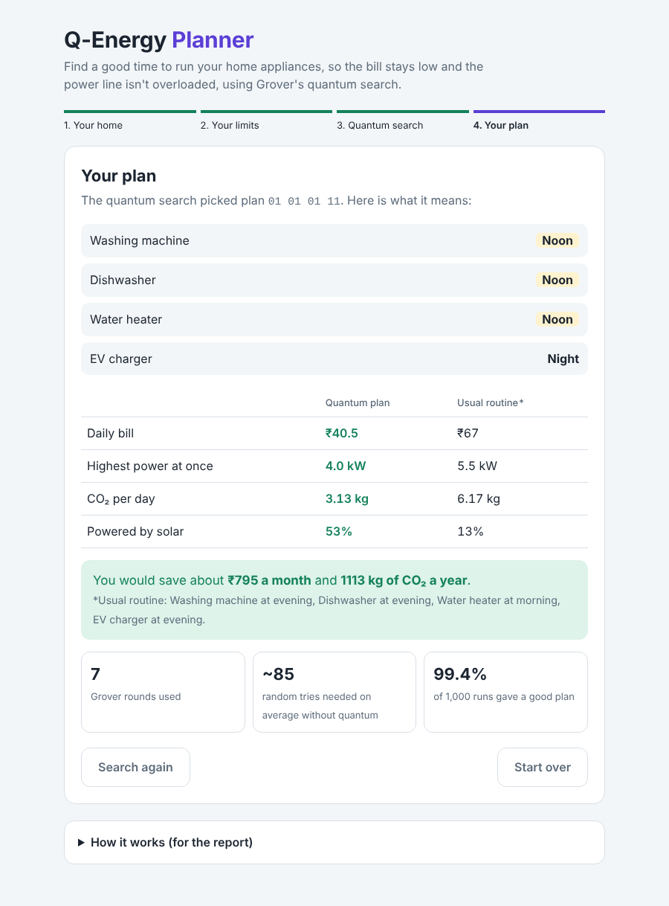

# Q-Energy

**Quantum-Assisted Smart Energy Scheduling Using Grover's Search Algorithm**

Q-Energy finds a good time to run each home appliance (washing machine, dishwasher, water heater, EV charger) so the electricity bill stays low and the house never draws too much power at once. The search is done by **Grover's quantum algorithm**, built with **Qiskit** and run on the **Qiskit Aer** quantum simulator.



---

## How to run it

You need **Python 3.10 or newer** ([python.org/downloads](https://www.python.org/downloads/); on Windows tick **"Add Python to PATH"** while installing).

| Computer | What to do |
|---|---|
| **Windows** | Double-click **`START_WINDOWS.bat`** |
| **Mac / Linux** | Open a terminal in this folder and run `./start_mac_linux.sh` |

The first start installs Qiskit (about a minute), then your browser opens at **http://localhost:5000**. To stop, close the black window or press Ctrl+C.

No Python? Open `web/index.html` directly in a browser. It runs the same search with a built-in simulator and shows a yellow "Browser simulation" label instead of "Running on Qiskit Aer".

---

## How to use it: 4 steps

| Step | What you do | What you see |
|---|---|---|
| **1. Your home** | Tap the times each appliance is allowed to run | How many of the 256 possible plans fit |
| **2. Your limits** | Move two sliders: highest daily bill, highest power at once | How many plans are "good" |
| **3. Quantum search** | Press **Start quantum search** | 256 dots, one per plan. Each round the good ones flash red (oracle), then grow (diffuser). Then one plan is measured. |
| **4. Your plan** | Read the result | When to run each appliance, the bill against your usual routine, monthly savings |

Open **"How it works (for the report)"** at the bottom of the page for the explanation and the actual circuit.

---

## What's in the folder

```
Q-Energy/
├── START_WINDOWS.bat          double-click to run (Windows)
├── start_mac_linux.sh         run (Mac / Linux)
├── app.py                     starts the web app
├── requirements.txt           qiskit, qiskit-aer, flask, pytest
├── qenergy/
│   ├── household.py           appliances, prices, how a plan is scored
│   └── grover.py              the quantum circuit (oracle, diffuser, search)
├── web/
│   ├── index.html             the page
│   └── app.js                 the page's buttons and animation
├── notebook/
│   └── Q_Energy_Grover.ipynb  the same project step by step, for Google Colab
├── tests/test_qenergy.py      18 automatic checks   (run: python -m pytest)
└── docs/
    ├── HOW_IT_WORKS.md        plain explanation + viva questions
    └── screenshots/
```

To change the household (prices, appliances, allowed times), edit the two lists at the top of `qenergy/household.py`.

## Results with the default household

| | |
|---|---|
| Possible plans | 2⁸ = 256 (8 qubits) |
| Good plans (bill ≤ ₹45, power ≤ 4 kW) | 3 |
| Grover rounds | 7 |
| Chance of a good plan, random guess | 1.2% |
| Chance of a good plan, after Grover | 99.7% in theory, 99.5–99.8% measured over 1,000 runs |
| Typical plan found | Washing machine morning, dishwasher and water heater at noon, EV at night: **₹42.1/day vs ₹67** for the usual evening routine (about ₹750 a month saved) |
